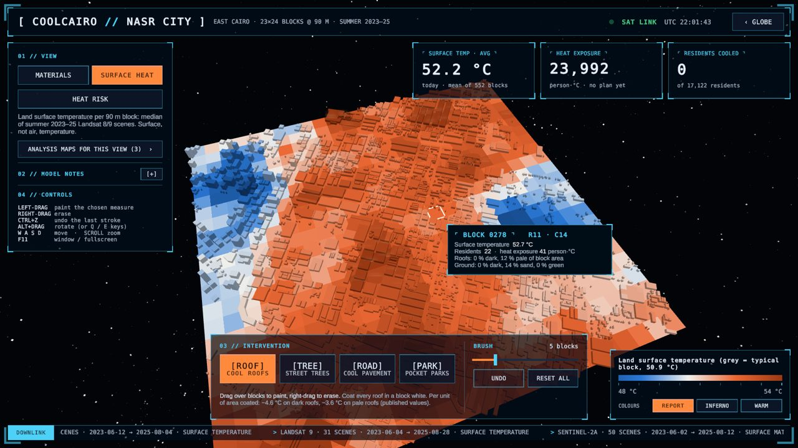
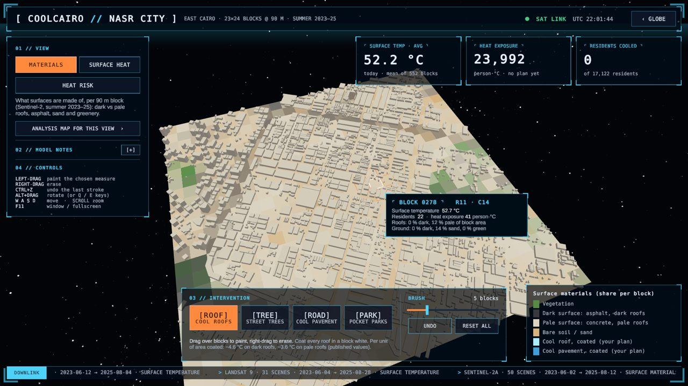

# UAE feasibility spike: Sharjah

Branch `spike/uae-city`, 24 Oct 2026. Question: can the CoolCairo pipeline, unchanged in method, produce a usable district for a UAE city? This is a roadmap check for "any city, automatically" (slide 14). It does not touch master or the Windows build used for the 28–29 Oct pitch.

**Verdict: GO, with conditions.** The pipeline ran end to end for Sharjah with a new config and four small code switches. It took about 6 minutes from an empty cache. The block model fits about as well as Cairo's (spatial-CV R² 0.27 vs 0.25), and the exported `district.json` loads and renders in the Unity app. Before Sharjah can be shown as a second *validated* district, three things are needed: real building heights, an urban-growth source, and locally recalibrated Sentinel-2 material thresholds. Recommendation: keep it out of the pitch build. At most, mention that the pipeline already ran on a UAE city.

## Area

| | Bbox (lon/lat) | Size | Notes |
| --- | --- | --- | --- |
| Display district | 55.395–55.415 E, 25.322–25.340 N | 23 × 24 blocks (2.1 × 2.0 km) | Abu Shagara / Al Qasimia / Al Majaz: dense mid-rise residential, east of Khalid Lagoon. No water blocks. |
| Model area | 55.34–55.47 E, 25.272–25.39 N | 21,904 blocks (~13 × 13 km) | Sharjah city, Al Nahda, Muwaileh, Al Qusais (Dubai) |

Config: [`analysis/config/aoi_sharjah.yaml`](../analysis/config/aoi_sharjah.yaml). It is a copy of `aoi.yaml`. Only the geography, CRS (UTM 40N, EPSG:32640), WorldPop country, live OSM and two source switches are changed. Every threshold and literature value is the Cairo one, so any differences come from the city, not the settings.

Run it (from `analysis/`; the Cairo files are never read or written):

```
COOLCAIRO_CONFIG=config/aoi_sharjah.yaml COOLCAIRO_DATA_DIR=data/sharjah \
COOLCAIRO_EXPORT_DIR=../export/sharjah uv run python run_pipeline.py
```

## Data sources

| Source | Result for Sharjah | Cairo for comparison |
| --- | --- | --- |
| Landsat 8/9 C2 L2 ST_B10, Jun–Aug 2023–25, cloud < 10% | **Works.** 54 scenes (L8 23, L9 31), 29 clear solar days in the median. 100% valid pixels. | 65 scenes |
| Sentinel-2 L2A, same window | **Works.** 98 scenes (2A 50, 2B 41, 2C 7). | 70 scenes |
| Sentinel-2 fly-in image | **Works after a fix.** No single tile covers the 24 km box (Sharjah sits on a tile edge), so the box now halves until one tile covers it: 12 km box, T40RCP, 2025-06-11. The image is cut off on the east and shows two smoke plumes. | 24 km box |
| WorldPop Global2 R2025A 2024, ARE, 100 m constrained | **Works.** The file exists (6.5 MB). The national total is 10.84 M, which is plausible. The server reset Python's download twice, so it was fetched with `curl -C -`. | |
| OpenStreetMap buildings (live, 24 Oct 2026) | **Works for footprints.** 114,708 in the model area, 3,672 in the district (Cairo: 1,901). **Heights: only 2.5% tagged** (1.0% `height`, 1.4% `building:levels`); the other 97.5% get the 5-storey default (16 m). Tagged buildings have a median of 40 m and a 90th percentile of 105 m, so the default badly underestimates Sharjah's towers. | Committed extract |
| Google Open Buildings 2.5D Temporal (heights + 2016–23 growth) | **Not available.** The HDX index has no `ARE_*.txt` list, and `SAU_*` has only 2 tiles (Red Sea). Switched off with `open_buildings: false`, so there are no heights from it and no Growth view. | Covered 74% of heights |
| EnMAP L2A (DLR STAC, no login needed to search) | **Scene exists, not downloaded.** 23 scenes over the model area, 12 of them at night. Only **2024-06-25 07:37 UTC (DT0000080909, tile 012; sun 80°; 24% cloud)** fully covers the district; 2024-01-11 covers 72%. Downloading it needs the EOC login, so `enmap: false` and no hyperspectral comparison. No raw EnMAP data was fetched or stored. | 2025-04-22 scene |

## Heat model (spatial CV, 1 km tiles, 5 folds)

| | Sharjah | Cairo (published) |
| --- | --- | --- |
| Training blocks (roof cover ≥ 10%) | 11,154 | 2,538 |
| **R² spatial CV** | **0.274** (0.257 with 2 km tiles, 0.248 with 3 km) | 0.250 (0.15 before Open Buildings heights) |
| R² train | 0.291 | 0.378 |
| MAE spatial CV | 1.43 °C | 1.20 °C |
| Urban median LST (heat reference) | 50.9 °C (p10 48.6, p90 54.0) | 45.7 °C |

Coefficients (°C per unit block fraction; bright paved ground is the reference):

| Feature | Sharjah | Cairo | Expected sign | Comment |
| --- | --- | --- | --- | --- |
| veg_frac | −3.13 | −3.15 | − | ✓ Almost identical to Cairo. |
| dark_roof_frac | −9.93 | −11.28 | + | ✗ Wrong sign, as in Cairo. In Sharjah it is also not identifiable: mean dark-roof share is 0.1%. Cool roofs keep the literature value (−4.64 / −3.60 °C per unit area). |
| dark_ground_frac | +2.47 | +0.12 | + | ✓ Clearer than in Cairo. |
| soil_frac | +6.59 | +3.36 | + | ✓ Open sand is hotter, twice the Cairo effect. |
| roof_frac | +3.71 | +2.29 | ? | Same sign as Cairo. |
| mean_height_m | −0.036 / m | −0.062 / m | − | ✓ Correct sign, but heights are 97.5% default, so it is weak. |

Display district: 552 blocks (467 urban), mean LST 52.2 °C, 17,122 residents, heat exposure 23,992 person·°C. At full adoption: cool roofs −66%, pocket parks −35%, cool pavements −5%, street trees −3%. Trees and pavements are small because only 4.4% of the ground classifies as "dark" (Cairo uses the same thresholds).

## Unity app

Test: a separate player was built from the worktree (`CoolCairo_uae/unity/Builds/`, git-ignored), with the Sharjah `district.json` and globe city 0 temporarily set to Sharjah. Both changes were reverted and are not committed. The master project, its `Library` and `unity/Builds/` were not touched.

- **Loads and renders: yes.** Schema 1 parses; 23 × 24 blocks and 3,672 buildings build into the combined mesh. The Materials, Surface heat and Heat risk views, the KPI cards, block popups, brush and scene ticker all work (screenshots below). Setup and build succeeded with 0 errors.
- **Self-test: 35 checks passed, then it stopped** with `InvalidOperationException` in `SelfTest.HottestBlock`. That fixture looks for a block with more than 5% dark roof, and Sharjah has none. The other remaining checks also hard-code Cairo values (6,460 person·°C), so this is a test assumption, not an app fault.
- **As a *second* district: no, not without app work.** The app holds one district: `district.json` is a TextAsset baked in at build time. The globe's live marker is hard-coded to Cairo (`IntroController.Cities`), and the HUD title says "NASR CITY · EAST CAIRO" (`HudBuilder.cs`, `IntroController.cs`). The analysis-map figures are Nasr City PNGs, the sharp globe patch stops at 43° E (Sharjah is at 55° E), and the Growth view needs Open Buildings. Needed: one JSON per city loaded at runtime (StreamingAssets), city markers taken from the JSON names and centres, a title from `data.name`, per-city figures, a wider globe patch, and a self-test that doesn't depend on Cairo.




*The header still reads "Nasr City": it is hard-coded (see above). Contains modified Copernicus Sentinel data [2023–2025]; OSM © OpenStreetMap contributors (ODbL).*

## Gaps and next steps (in order)

1. **Building heights.** OSM alone gives 97.5% default. Candidates with UAE coverage, not tested here: DLR **WSF 3D** (90 m building height and volume, which matches the 90 m blocks), **GHSL GHS-BUILT-H** (100 m mean height), and Microsoft Global ML Building Footprints (check whether it has UAE heights).
2. **Urban growth.** Replace Open Buildings Temporal with **GHSL GHS-BUILT-S** (built-up surface by epoch) or WSF Evolution.
3. **Material thresholds.** The Cairo `brightness_dark_max` (0.14) and `bsi_soil_min` (0.137) leave almost no dark roofs or dark ground in Sharjah. Rerun the notebook-02 BSI calibration (inside footprints vs open sand) for Sharjah, and spot-check 20 roofs.
4. **Population check.** 17,122 residents in 4.5 km² (≈ 3,800 per km²) looks low for Abu Shagara / Al Qasimia. Compare WorldPop with the Sharjah 2022 census by district before using heat-exposure numbers.
5. **EnMAP.** Download 2024-06-25 (tile 012) to repeat the hyperspectral value test. Note its 24% scene cloud.
6. **App.** Make it multi-district as listed above. This is after the pitch, on a branch, never in the pitch build.

## Code changes on this branch

All of them keep Cairo's behaviour byte-identical. The branch's pipeline on `aoi.yaml`, run against the existing Cairo caches, exported a `district.json` identical to the committed one. The 24 unit tests pass.

- `config.py`: `COOLCAIRO_CONFIG`, `COOLCAIRO_DATA_DIR` and `COOLCAIRO_EXPORT_DIR` env vars, relative to `analysis/`. Defaults are the Cairo paths. They stop a second city from overwriting Cairo's caches, because cache file names are fixed.
- `pipeline.py`: `open_buildings: false` skips Open Buildings heights and growth (the Growth view gets `available: 0`); `enmap: false` skips the hyperspectral summary.
- `stac.py`: the fly-in box halves (down to a quarter) until one Sentinel-2 tile covers it.
- `run_pipeline.py`: the buildings provenance string follows `open_buildings`.

Output: `export/sharjah/district.json` (337 KB), committed so the team can load it.
